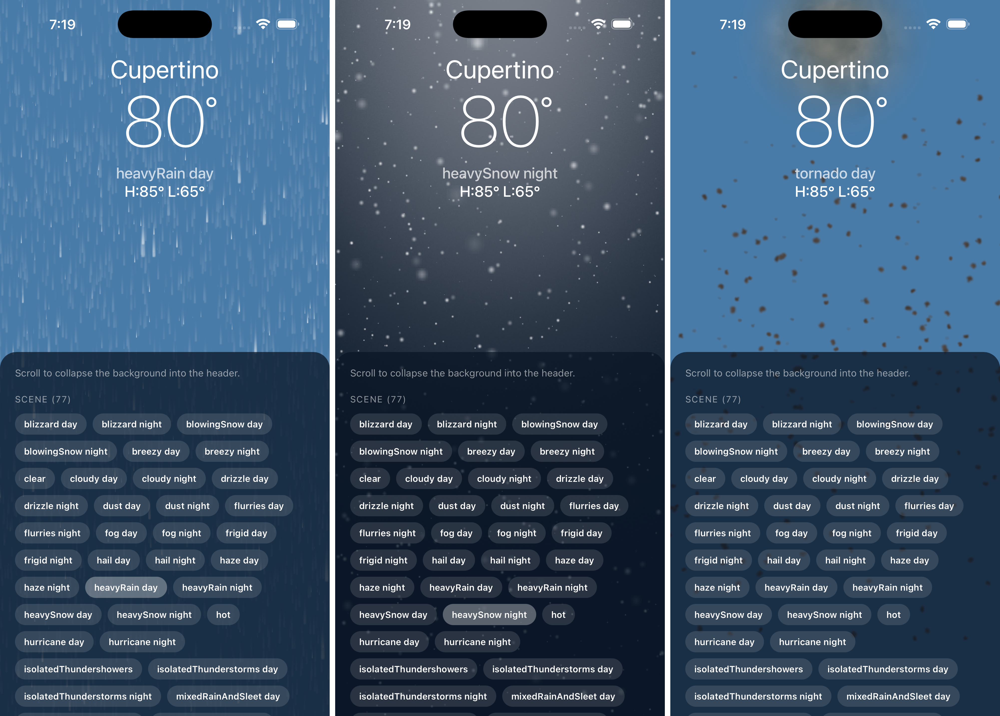

# weather-app

<p align="center">
  
</p>

Recreates the iOS Weather app's animated backgrounds in Expo, driven by the
scene data extracted from the app bundle's `Mica/` directory.

<p align="center">
  
</p>

## How it works

The Weather bundle ships **two** background systems. This project uses the
older one, `Mica/`, for reasons covered in [Why Mica and not
VFX](#why-mica-and-not-vfx).

Apple ships 537 `.caml` files — one per weather condition × day/night × device
size. They are plain Core Animation XML: layer trees, tiled scrolling images,
and `CAEmitterLayer` particle systems with full cell parameters and behaviors.
Everything needed to redraw a scene is in the file; nothing is hidden in code.

`tools/caml_to_scene.py` converts one condition into a compact runtime JSON and
copies the sprites it references. `src/engine/` renders that JSON with
react-native-skia.

```
tools/caml_to_scene.py        .caml -> runtime scene JSON + sprites

src/app/                      expo-router routes (_layout, index)
src/components/               screen-level UI
src/constants/                collapse geometry, sky colours

src/engine/                   the renderer, self-contained
  types.ts                    scene/emitter/cell shapes
  emitter.ts                  CAEmitterCell-equivalent simulation (worklets)
  CellLayer.tsx               one cell -> one Skia Atlas draw call
  TileLayer.tsx               tiled/scrolling image layers
  states.ts                   LKState resolution (Full / Mini / Landscape)
  WeatherScene.tsx            composes a scene, scales it to the device
  assets.ts                   generated registry Metro can resolve
```

Routing is expo-router with `src/app` as the routes directory; `@/*` is aliased
to `src/*`. `src/engine/` is kept whole rather than split across
`components/`/`hooks/`: it is a library with one public entry point
(`WeatherScene`) and no knowledge of the app around it.

## Converting scenes

```sh
# every condition, plus a regenerated src/engine/assets.ts
python3 tools/caml_to_scene.py /path/to/Extracted_IOS_Files/Mica --all

# just one
python3 tools/caml_to_scene.py /path/to/Extracted_IOS_Files/Mica snow_night
```

`--all` produces all **77 scenes** (42 conditions × day/night, plus the
time-independent `clear`, `hot`, `mostlySunny`, `rainbow`) and writes the
registry, since Metro needs static `require` paths. Single-condition runs leave
the registry alone, so add the entry by hand or re-run `--all`.

## Things worth knowing about the format

**The design space is y-up.** Scenes are authored at a fixed 640×1136 with a
bottom-left origin, held by a layer named `Rotation` that is uniformly scaled to
cover the device. The converter flips to y-down. This is confirmed by the `Mini`
state, which culls the rain emitter to design y 846..2046 — the top 290px of the
screen once flipped, i.e. the collapsed header.

**Most cells take their direction from the container.** 701 of 903 cells carry
no `emissionLongitude` at all, so their travel direction comes from the
`Rotation` layer the app turns at runtime. That is also how the app tilts
precipitation with wind: change `scene.rotation` (π/2 is straight down) and
rain slants.

**There are no gradient layers.** Zero `CAGradientLayer` instances across all
537 files — skies ship as pre-rendered PNGs, so `src/constants/sky.ts` supplies
a flat backdrop.

**Additive layers need the sky inside the canvas.** 377 emitters use
`renderMode="cheapAdditive"`, and additive sprites are authored on black
because black adds nothing. `plus` blending adds alpha too, so over a
*transparent* canvas those sprites add onto transparent black and composite as
opaque black rectangles — a black band across the top of every storm scene.
The sky therefore has to be painted inside the Skia canvas (`<Fill>`), not as a
React Native view behind it, so the additive layers have something to add onto.

**Emission angles negate on the y-flip, and 0 means "unspecified".** 202 cells
carry an explicit `emissionLongitude`, authored in the y-up design space, so
the angle negates along with the geometry. Every non-zero value in the corpus
lands somewhere downward that way: thunderstorm −90° → straight down, blizzard
−162° and tropicalStorm −151° → steep wind-blown slants, the shooting star
−70° → down and to the right. A literal `0` is Apple's tooling writing the
default rather than "point along +x" — `rain_night` omits the attribute
entirely and must still fall — so 0 falls back to the container's downward
direction. Getting this wrong sends blizzard snow flying upward.

**Cull rects use ±DBL_MAX for "unbounded".** An axis Apple doesn't want clipped
is stored as ±1.797e308 rather than omitted, so flipping it arithmetically
collapses it to zero and culls the entire scene. The converter special-cases it.

**The visible band falls out of the cull rects.** `WeatherScene` derives the
region of design space a state actually shows by clipping every emitter's cull
rect to the canvas, then aligns that band's bottom to the visible height. No
state needs special-casing: `Full`'s rects are wider than the canvas so it
yields the whole scene, while `Mini`'s clip to the collapsed header strip. That
is what lets the route drive the collapse straight from scroll position.

**States are real animation data.** Each scene carries `Full`, `Mini` and
`Landscape` as key-path overrides against layer ids, with spring stiffness and
damping values suitable for feeding straight into Reanimated.

## Simulation model

Apple's emitters are steady-state: a constant birth rate feeding a fixed
lifetime. So instead of mutable particle state, each particle index owns a
deterministic seed and its entire life is a pure function of the clock. Each
atlas slot is evaluated independently, straight from the clock — there is no
cross-frame state for Reanimated to serialize, nothing to compact when a
particle dies, and no per-frame allocation. The field is already full on the
first frame.

Implemented: birth rate, lifetime (+range), velocity (+range), emission angle
and range, x/y acceleration, scale (+range, +speed), alpha (+range, +speed),
spin (+range), cull rects, sprite-sheet frames (`contentsFrameCount` /
`contentsFramesPerRow` / `contentsFrameMode`), render modes (Apple's
`cheapAdditive` → Skia `plus`), path emitters with `sequential` emission, burst
scheduling (`beginTime` / `duration` / `repeatCount`), and the `valueOverLife`,
`valueOverDistance`, `colorOverLife`, `wave`, `attractor` and `alignToMotion`
behaviors. The attractor is an approximation — a distance-falloff pull rather
than Core Animation's exact force model.

Not implemented: the `light` behavior (35 uses), `emissionLatitude` (the scenes
are effectively 2D), and `CAEmitterCell.particleType` variants beyond sprites.

### Bursts are still stateless

Lightning looked like it would force a mutable simulation, but it doesn't:
Apple's bolts repeat on a fixed cycle, so they stay a pure function of the
clock. A burst cell emits across a short `window` that recurs every `period`,
and `age` is derived from `clock mod period`. Two subtleties matter:

- **Nested time.** Core Animation composes timing down the tree — a child's
  local time is `(parent_time - beginTime) * speed`. Flattening the layer tree
  loses that, so the converter folds it into one `(beginTime, speed)` pair per
  emitter. Without it every bolt inherits phase 0 and the whole storm fires at
  once instead of staggering across 16s, 23s, 24s, 40s…
- **Inherited windows.** A child's active window is clipped by its parent's.
  The bolt branches declare no `duration` of their own, so they must inherit
  the parent bolt's cycle; treated as continuous emitters they glow forever.

A thunderstorm is 62 emitters and 99 cells, of which 60 are path emitters — 12
strikes of roughly 5 branches each, one firing every ~12 seconds.

## Why Mica and not VFX

The extracted bundle contains two separate background systems:

| | `Mica/` | `VFX/` |
|---|---|---|
| era | iOS 14 (Core Animation) | iOS 15+ (VFXCore) |
| contents | 537 `.caml` + 96 PNG | 1 ECS scene graph + ~460 textures |
| parameter values | **inline in the XML** | **absent — compiled into the binary** |
| runtime needed | a `CAEmitterCell` equivalent | Apple's private ECS engine + Metal shaders |

This project is 100% Mica: all 83 sprites are PNGs from that directory, with no
`.ktx`/`.heic` files and none of the `_POS`/`_NEG`/`_ALPHA` triplets that mark
the VFX set.

**Mica is self-describing.** Every value needed to redraw a scene — gradients,
birth rates, velocities, lifetimes, colour ramps, the lightning paths — sits in
readable XML. That is the whole reason this project was tractable.

**VFX is machinery without numbers.** `WeatherCombinedV75_Background.vfx` is a
610-entity ECS scene graph exposing 187 named parameters (`gradientTop`,
`sunAngle`, five cloud layers, `lightningNumberOfBranches`, …) and shipping *no
values for any of them*. The per-condition presets are compiled into the
`Weather` executable — grepping the binary for those parameter names hits
plaintext, so they are in there, just not as data. Using VFX therefore means
both reimplementing an undocumented particle runtime *and* recovering ~187
floats × 77 conditions out of a Mach-O.

### What Mica costs you

VFX genuinely looks better. Its cloud textures ship as POS/NEG/ALPHA triplets —
a pre-baked lighting trick that blends positive- and negative-lit variants by
sun angle, giving clouds that respond to time of day. It also computes the sky
gradient dynamically, whereas Mica ships flat PNG skies (which is why
`src/constants/sky.ts` has to pick a backdrop colour by hand).

### The middle path

You can keep this engine and adopt the VFX *art* without the VFX runtime: swap
in the cloud textures and drive the POS/NEG blend from a sun-angle value you
supply yourself. The textures need KTX/HEIC → PNG conversion first.

### Unchecked lead

`PlugIns/WeatherWidget.appex/` contains `ClearDay.json` and `RainyDay.json`.
Condition-named JSON sitting beside the widget is exactly where a preset table
would live. If those hold VFX parameter values, the trade-off above changes
considerably — you would have the format, and the remaining conditions likely
follow the same shape. Their contents have not been examined.
